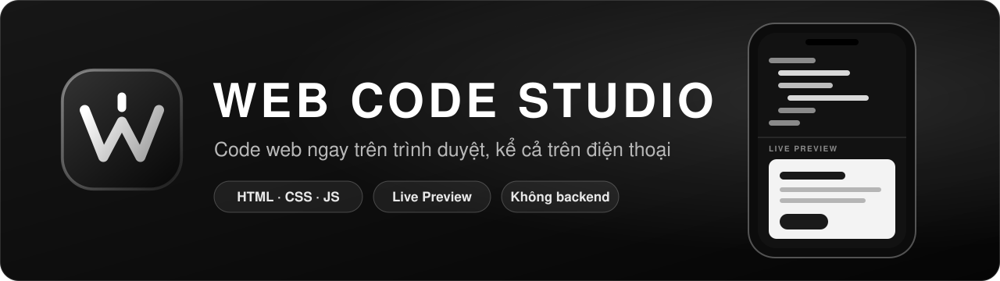
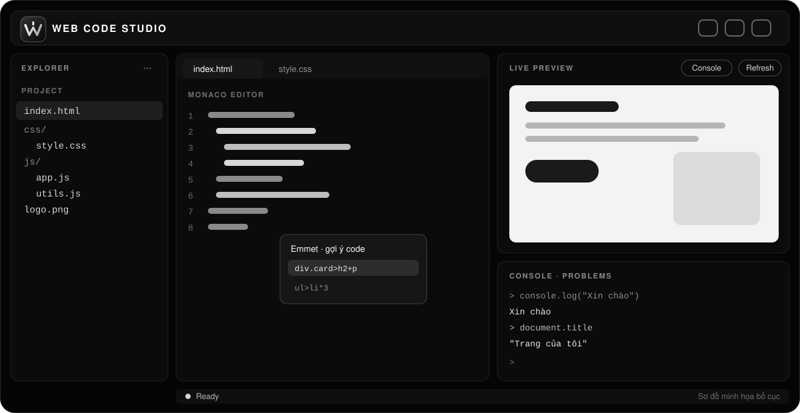
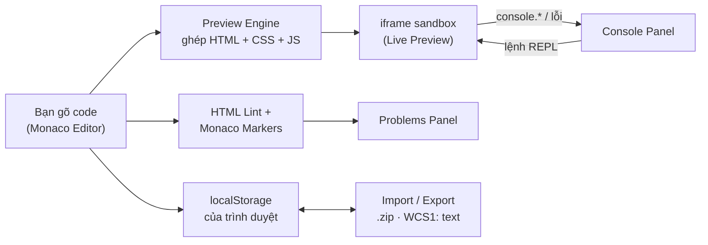

<div align="center">



<br/>

### Trình soạn thảo HTML · CSS · JavaScript chạy ngay trên trình duyệt — Live Preview, Console, Emmet, Command Palette. Không backend, không đăng ký, không cài đặt.

<br/>

[](#)
[](#giấy-phép)
[](https://microsoft.github.io/monaco-editor/)
[](#cách-1--deploy-hosting-tĩnh-github-pages-netlify-vercel)
[](#)

<br/>

**[Tính năng](#tính-năng-nổi-bật) · [Cách chạy](#cách-chạy-project) · [Phím tắt](#phím-tắt) · [Cấu trúc](#cấu-trúc-project) · [FAQ](#faq--xử-lý-sự-cố)**

</div>

<br/>

<!--
  GỢI Ý: Chụp 1 ảnh màn hình giao diện, lưu vào docs/screenshot.png rồi bỏ comment dòng dưới:
  <p align="center"></p>
-->

---

## Giới thiệu

**Web Code Studio (WCS)** là một trình soạn thảo mã nguồn thu nhỏ dành cho web, mang trải nghiệm giống **VS Code** vào trình duyệt. Bạn viết HTML, CSS, JavaScript và thấy kết quả **cập nhật trực tiếp** ngay bên cạnh, kể cả trên điện thoại.

### Giao diện

<p align="center">
  
</p>

<p align="center"><sub>Sơ đồ minh họa bố cục: Explorer bên trái, trình soạn thảo ở giữa, Live Preview và Console bên phải. Trên điện thoại, Explorer thu thành ngăn kéo.</sub></p>

### Mục đích ra đời

Trên máy tính, học lập trình web rất dễ: cài VS Code, mở trình duyệt là xong. Nhưng trên **điện thoại** thì khác. Rất ít ứng dụng cho phép lập trình web với trải nghiệm gần giống VS Code: có gợi ý code, Emmet, quản lý nhiều file và thư mục, xem trước trực tiếp, console để debug. Nhiều bạn học sinh chỉ có điện thoại trong tay, hoặc muốn luyện tập ngay ở bất cứ đâu.

WCS được tạo ra để lấp khoảng trống đó:

| Dành cho | Vì sao phù hợp |
|----------|----------------|
| **Học sinh** học HTML / CSS / JavaScript | Mở bằng một đường link là dùng được ngay, không cài app, không tạo tài khoản, không cần máy tính |
| **Project ngắn hạn** (bài tập, trang web nhỏ, demo, thử nghiệm ý tưởng) | Tạo file, viết code, xem kết quả trong cùng một màn hình; xuất `.zip` hoặc chia sẻ bằng chuỗi văn bản khi xong |
| **Người dùng điện thoại** | Giao diện responsive, có nút Format, Find, Command Palette riêng cho màn hình cảm ứng |

> [!NOTE]
> WCS không nhằm thay thế VS Code cho các project lớn. Dung lượng project bị giới hạn khoảng 5 MB (do `localStorage`), và công cụ này tập trung vào **web tĩnh** (HTML, CSS, JavaScript thuần). Với project dài hạn hoặc nhiều người cùng làm, hãy dùng VS Code kèm Git.

### Không cần backend

Toàn bộ logic chạy ở **phía client**. Project của bạn được lưu trong **`localStorage` của trình duyệt**, không có database, không có API, không gửi mã nguồn lên bất kỳ server nào. Vì vậy WCS có thể chạy theo **nhiều cách**: deploy lên hosting tĩnh miễn phí, dùng một static server bất kỳ, hoặc mở thẳng file.

> [!NOTE]
> File `server.js` (Express) chỉ có một nhiệm vụ: **phục vụ file tĩnh trong `public/`**. Nếu bạn đã có sẵn một static server khác thì **không cần Node.js** để chạy project này.

---

## Tính năng nổi bật

<table>
<tr>
<td width="50%" valign="top">

### 🖊️ Trình soạn thảo
- Nền tảng **Monaco Editor** (lõi của VS Code)
- Theme tối tối giản tự thiết kế `wcs-premium`
- **Gợi ý code thông minh** cho HTML / CSS / JS
- **Emmet**: `Tab` để bung viết tắt trong HTML, CSS và cả `<style>`
- **Format code**: HTML, CSS/SCSS/LESS, JS/TS, JSON
- Bật/tắt Word Wrap, Minimap, đổi cỡ chữ
- Nhiều **tab**, tự khôi phục tab đang mở sau khi tải lại trang

</td>
<td width="50%" valign="top">

### ⚡ Live Preview
- Tự render lại khi bạn gõ (debounce ~350 ms)
- Khung xem trước giả lập màn hình desktop **1366 × 768**
- Chạy trong `iframe` **sandbox** an toàn
- Hỗ trợ **nhiều trang HTML** liên kết với nhau
- Đọc được file nội bộ qua `fetch` / XHR
- `localStorage` / `sessionStorage` của trang preview được giả lập riêng, không đè dữ liệu của editor

</td>
</tr>
<tr>
<td width="50%" valign="top">

### 🐞 Console & Problems
- **Console** tích hợp: nhận `console.*` và lỗi runtime từ preview
- **JavaScript REPL**: gõ lệnh và chạy ngay trong trang đang preview
- Lọc log, xóa log, giữ log khi preview chạy lại
- Bảng **PROBLEMS** kiểu VS Code: gom lỗi của **mọi file** trong project
- **HTML Lint** tự viết: thẻ chưa đóng, `id` trùng, `` thiếu `alt`, `href`/`src` trỏ tới file không tồn tại…

</td>
<td width="50%" valign="top">

### 📁 Quản lý project
- **Explorer** có thư mục lồng nhau, tạo file/thư mục mới
- **Upload** ảnh, `.html`, `.css`, `.js`, `.json`
- **Import / Download** project dạng `.zip` (tự viết bộ nén zip, không dùng thư viện)
- **Share Project**: gói cả project thành **một chuỗi văn bản** `WCS1:…` để gửi cho bạn bè
- Tìm & thay thế **trong file** và **trong toàn project** (Aa / từ nguyên / Regex)

</td>
</tr>
<tr>
<td colspan="2" valign="top">

### 🧭 Điều hướng nhanh · Responsive
**Command Palette** (`Ctrl+Shift+P` / `F1`), **Quick Open** (`Ctrl+P`), **Go to Line** (`Ctrl+G`). Giao diện responsive, có sidebar dạng ngăn kéo và nút thao tác riêng cho thiết bị cảm ứng (Format, Find, Palette) nên dùng khá thoải mái cả trên điện thoại.

</td>
</tr>
</table>

---

## Cách hoạt động



- **Không có dữ liệu nào rời khỏi máy bạn.** Chỉ có một request ra ngoài: tải Monaco Editor từ CDN (cdnjs).
- Server Node.js (nếu bạn dùng) **chỉ trả file tĩnh**, không lưu gì cả.

---

## Cách chạy project

Chọn **một** trong các cách dưới đây. Vì đây là project **thuần tĩnh** (không backend), cách dễ nhất là đưa nó lên hosting tĩnh và dùng ngay bằng một đường link.

| # | Cách chạy | Cần cài | Phù hợp khi |
|:-:|-----------|:-------:|-------------|
| 1 | [Deploy hosting tĩnh (GitHub Pages, Netlify, Vercel…)](#cách-1--deploy-hosting-tĩnh-github-pages-netlify-vercel) | Chỉ cần tài khoản | **Khuyên dùng** — có link online, dùng được trên mọi thiết bị |
| 2 | [Static server trên máy](#cách-2--static-server-trên-máy-localhost) | Python / Node / PHP / VS Code | Phát triển, sửa code cục bộ |
| 3 | [Mở trực tiếp `index.html`](#cách-3--mở-trực-tiếp-file-không-cần-cài-gì) | Không | Dùng thử nhanh |
| 4 | [Node.js + Express](#cách-4--nodejs--express) | Node.js 18+ | Muốn dùng `npm start` có sẵn |

> [!IMPORTANT]
> **Yêu cầu chung cho mọi cách:** cần **Internet** ở lần tải trang, vì Monaco Editor `0.52.2` được nạp từ `cdnjs.cloudflare.com`. Nếu bị chặn mạng, thanh trạng thái sẽ hiện **Offline** và editor sẽ không khởi động. Xem [FAQ](#faq--xử-lý-sự-cố) để chạy offline hoàn toàn.

### Bước 0 — Lấy mã nguồn

```bash
git clone https://github.com/<your-username>/web-code-studio.git
cd web-code-studio
```

Hoặc bấm **Code → Download ZIP** trên GitHub rồi giải nén.

---

### Cách 1 — Deploy hosting tĩnh (GitHub Pages, Netlify, Vercel…)

Toàn bộ ứng dụng nằm trong thư mục **`public/`**. Bạn chỉ cần đưa thư mục này lên một dịch vụ hosting tĩnh: **không cần build command, không cần Node.js, không cần cấu hình server**. Mọi đường dẫn trong project đều là đường dẫn tương đối nên chạy tốt cả khi nằm trong thư mục con như `/<tên-repo>/`.

| Dịch vụ | Build command | Publish / Output directory |
|---------|:-------------:|:--------------------------:|
| **GitHub Pages** | *(không có)* | `public` (qua GitHub Actions) |
| **Netlify** | *(để trống)* | `public` |
| **Vercel** | *(để trống)* | `public` |
| **Cloudflare Pages** | *(để trống)* | `public` |

#### GitHub Pages

GitHub Pages chỉ cho chọn thư mục gốc `/` hoặc `/docs` khi deploy từ branch. Vì ứng dụng nằm trong `public/`, cách gọn nhất là dùng **GitHub Actions**.

**Bước 1.** Đẩy code lên GitHub (nhánh `main`).

**Bước 2.** Vào repo → **Settings → Pages → Build and deployment → Source** → chọn **GitHub Actions**.

**Bước 3.** Tạo file `.github/workflows/pages.yml`:

```yaml
name: Deploy to GitHub Pages

on:
  push:
    branches: [main]
  workflow_dispatch:

permissions:
  contents: read
  pages: write
  id-token: write

concurrency:
  group: pages
  cancel-in-progress: true

jobs:
  deploy:
    runs-on: ubuntu-latest
    environment:
      name: github-pages
      url: ${{ steps.deployment.outputs.page_url }}
    steps:
      - uses: actions/checkout@v4
      - uses: actions/configure-pages@v5
      - uses: actions/upload-pages-artifact@v3
        with:
          path: public
      - id: deployment
        uses: actions/deploy-pages@v4
```

**Bước 4.** Commit và push. Vào tab **Actions** theo dõi tiến trình; khi xong, trang sẽ có tại:

```text
https://<your-username>.github.io/<tên-repo>/
```

<details>
<summary>Cách khác không cần Actions: dùng thư mục <code>/docs</code></summary>

Đổi tên `public/` thành `docs/` (hoặc copy nội dung `public/` vào `docs/`), push lên GitHub, rồi vào **Settings → Pages → Source: Deploy from a branch** → chọn nhánh `main` và thư mục **`/docs`**.

> Nếu đổi tên thư mục, nhớ cập nhật `server.js` (đường dẫn `public`) nếu bạn vẫn muốn dùng `npm start`.

</details>

#### Netlify

<details open>
<summary><b>Cách A — Kéo thả, không cần Git (nhanh nhất)</b></summary>

1. Vào [app.netlify.com/drop](https://app.netlify.com/drop)
2. **Kéo thả thư mục `public/`** vào trang
3. Vài giây sau bạn nhận được link dạng `https://ten-ngau-nhien.netlify.app`

</details>

<details>
<summary><b>Cách B — Kết nối repo GitHub (tự deploy mỗi khi push)</b></summary>

1. **Add new site → Import an existing project** → chọn repo của bạn
2. Điền:
   - **Build command:** *(để trống)*
   - **Publish directory:** `public`
3. Bấm **Deploy**

Hoặc tạo file `netlify.toml` ở thư mục gốc:

```toml
[build]
  publish = "public"
```

</details>

#### Vercel

1. Vào [vercel.com/new](https://vercel.com/new) → **Import** repo GitHub
2. **Framework Preset:** `Other`
3. **Build Command:** *(để trống)* · **Output Directory:** `public`
4. Bấm **Deploy**

Hoặc dùng CLI:

```bash
npm i -g vercel
vercel --prod
# Khi được hỏi Output Directory, nhập: public
```

#### Cloudflare Pages

1. **Workers & Pages → Create → Pages → Connect to Git** → chọn repo
2. **Build command:** *(để trống)* · **Build output directory:** `public`
3. Bấm **Save and Deploy**

> [!TIP]
> Dịch vụ nào cũng cấp HTTPS miễn phí. Mỗi domain/đường link có kho `localStorage` riêng, nên project bạn viết ở link này sẽ **không** tự xuất hiện ở link khác. Hãy dùng **Download Project (.zip)** hoặc **Share Project** để mang project đi nơi khác.

---

### Cách 2 — Static server trên máy (localhost)

Chạy `public/` như một website tĩnh qua `http://localhost`. Chọn công cụ bạn đang có:

<details open>
<summary><b>Python</b> &nbsp;(đã cài sẵn trên macOS / Linux, dùng được trên Windows)</summary>

```bash
# Từ thư mục gốc của project
python3 -m http.server 8080 --directory public
# Windows có thể dùng:  python -m http.server 8080 --directory public
```

Mở **http://localhost:8080**

</details>

<details>
<summary><b>Node.js — <code>npx serve</code></b></summary>

```bash
npx serve public -l 8080
```

Mở **http://localhost:8080**

</details>

<details>
<summary><b>Node.js — <code>http-server</code></b></summary>

```bash
npx http-server public -p 8080 -c-1
```

`-c-1` tắt cache để bạn luôn thấy bản mới nhất khi sửa code.
Mở **http://localhost:8080**

</details>

<details>
<summary><b>VS Code — Live Server</b></summary>

1. Cài extension **Live Server** (Ritwick Dey)
2. Chuột phải vào `public/index.html` → **Open with Live Server**

</details>

<details>
<summary><b>PHP</b></summary>

```bash
php -S localhost:8080 -t public
```

Mở **http://localhost:8080**

</details>

<details>
<summary><b>Nginx / Apache</b></summary>

Trỏ `root` (Nginx) hoặc `DocumentRoot` (Apache) vào thư mục `public/`. Không cần rewrite rule hay cấu hình đặc biệt nào, vì đây chỉ là một trang tĩnh.

```nginx
server {
    listen 80;
    server_name wcs.local;
    root /đường/dẫn/tới/web-code-studio/public;
    index index.html;
}
```

</details>

---

### Cách 3 — Mở trực tiếp file (không cần cài gì)

Không cần cài gì cả.

1. Vào thư mục **`public/`**
2. **Nhấp đúp** vào **`index.html`** (hoặc kéo thả vào cửa sổ trình duyệt)

```text
public/index.html   ← mở file này bằng Chrome / Edge / Firefox / Safari
```

> [!WARNING]
> Mở bằng giao thức `file://` thường chạy được, nhưng một số trình duyệt hạn chế Web Worker và `localStorage` với `file://`, khiến editor chậm hơn hoặc dữ liệu không được giữ lại. Nếu gặp vấn đề, hãy chuyển sang **Cách 1** hoặc **Cách 2**.

---

### Cách 4 — Node.js + Express

Dùng server đi kèm project nếu bạn muốn chạy bằng `npm`.

**Yêu cầu:** [Node.js](https://nodejs.org/) **18 trở lên** (Express 5 không hỗ trợ bản cũ hơn).

```bash
# 1. Cài dependency (chỉ có express)
npm install

# 2. Chạy server
npm start
```

Mở **http://localhost:3000**

| Lệnh | Tác dụng |
|------|----------|
| `npm start` | Chạy `node server.js` |
| `npm run dev` | Chạy `node --watch server.js`, tự khởi động lại khi bạn sửa `server.js` |
| `PORT=8080 npm start` | Đổi cổng (macOS / Linux) |

<details>
<summary>Đổi cổng trên Windows</summary>

```powershell
# PowerShell
$env:PORT=8080; npm start
```

```cmd
:: CMD
set PORT=8080 && npm start
```

</details>

Server lắng nghe ở `0.0.0.0`, nên bạn có thể mở từ điện thoại trong cùng mạng Wi-Fi bằng `http://<IP-máy-tính>:3000`. Ngoài file tĩnh, server còn có một endpoint chẩn đoán:

```bash
curl http://localhost:3000/api/status
```

---

## Hướng dẫn sử dụng nhanh

1. **Tạo file:** bấm `⋯` ở thanh **EXPLORER** → **New File** → đặt tên `index.html`
2. **Viết code:** gõ `!` rồi nhấn `Tab` (Emmet) để sinh khung HTML
3. **Xem kết quả:** khung **LIVE PREVIEW** tự cập nhật; bấm `Ctrl+Enter` để chạy lại thủ công
4. **Debug:** bấm nút **Console** trên khung preview (hoặc `` Ctrl+` ``) để xem log và chạy lệnh JS
5. **Lưu / chia sẻ:** dùng menu `⋯` → **Download Project (.zip)** hoặc **Share Project**

### Chia sẻ project bằng văn bản

**Share Project** nén toàn bộ file + thư mục thành một chuỗi dạng `WCS1:<dữ liệu>` (JSON → nén `deflate-raw` → base64url). Người nhận mở WCS, vào tab **Receive** rồi dán chuỗi là có lại nguyên project. Nếu trình duyệt không hỗ trợ nén, WCS tự chuyển sang định dạng `WCS0:` (không nén).

### Giới hạn

| Hạng mục | Giới hạn |
|----------|----------|
| File text (`.html` `.css` `.js` `.json`) khi upload | 1 MB / file |
| File ảnh khi upload | 2 MB / file |
| Dung lượng toàn project | ~5 MB (giới hạn `localStorage` của trình duyệt) |
| Dữ liệu sau giải nén khi nhận project | 24 MB |

Ảnh được hỗ trợ: `png` `jpg` `jpeg` `gif` `webp` `svg` `ico` `bmp` `avif`.

---

## Phím tắt

> Trên macOS, thay `Ctrl` bằng `Cmd` ở các tổ hợp của Monaco. Dùng **Command Palette** để xem đầy đủ lệnh.

| Phím tắt | Chức năng |
|----------|-----------|
| `Ctrl + Shift + P` / `F1` | Mở **Command Palette** |
| `Ctrl + P` | **Quick Open** — nhảy tới file |
| `Ctrl + G` | **Go to Line** |
| `Ctrl + S` | Lưu file |
| `Ctrl + Enter` | Chạy / làm mới **Preview** |
| `` Ctrl + ` `` | Bật / tắt **Console** |
| `Ctrl + F` | Tìm trong file |
| `Ctrl + H` | Thay thế trong file |
| `Ctrl + Shift + F` | Tìm trong **toàn project** |
| `Ctrl + Shift + H` | Thay thế trong **toàn project** |
| `Ctrl + Alt + Enter` | **Replace All** (trong panel Find) |
| `Shift + Alt + F` | **Format** code |
| `Tab` | Bung viết tắt **Emmet** |
| `Alt + Shift + W` | Emmet: **Wrap with Abbreviation** |
| `Ctrl + Shift + Y` | Emmet: **Evaluate Math Expression** |

---

## Cấu trúc project

```text
web-code-studio/
├── package.json              # Metadata + script npm (start / dev)
├── server.js                 # Express: chỉ phục vụ file tĩnh trong public/
└── public/                   # Toàn bộ ứng dụng nằm ở đây (có thể host tĩnh)
    ├── index.html            # Giao diện chính
    ├── favicon.svg           # Logo "W" + con trỏ nhấp nháy
    ├── css/
    │   └── style.css         # Toàn bộ giao diện & responsive
    └── js/
        ├── app.js            # Khởi tạo, sidebar, zip import/export, upload
        ├── editor.js         # Monaco, theme, tab, lưu localStorage
        ├── preview.js        # Live Preview engine + runtime sandbox
        ├── console.js        # Console + JavaScript REPL
        ├── diagnostics.js    # Bảng PROBLEMS, đẩy marker vào Monaco
        ├── html-lint.js      # Bộ kiểm tra HTML nhẹ, tự viết
        ├── autocomplete.js   # Gợi ý code
        ├── html-data.js      # Dữ liệu thẻ / thuộc tính HTML
        ├── emmet.js          # Tích hợp Emmet vào Monaco
        ├── emmet-engine.js   # Engine Emmet
        ├── palette.js        # Command Palette · Quick Open · Go to Line
        ├── find.js           # Find / Replace trong project
        ├── replace-core.js   # Lõi xử lý thay thế
        ├── format.js         # Nút Format code
        ├── share.js          # Share project dạng văn bản (WCS1:)
        ├── explorer-menu.js  # Menu thao tác ở Explorer
        └── empty-state.js    # Màn hình khi chưa mở file nào
```

### Công nghệ

| | |
|---|---|
| **Editor** | [Monaco Editor](https://microsoft.github.io/monaco-editor/) `0.52.2` (nạp từ cdnjs) |
| **Giao diện** | HTML5 + CSS3 thuần, không framework |
| **Logic** | Vanilla JavaScript, không bundler, không bước build |
| **Lưu trữ** | `localStorage` (`wcs_browser_files_v1`, `wcs_browser_folders_v1`, `wcs_browser_assets_v1`, `wcs_open_tabs_v1`) |
| **Server (tùy chọn)** | Node.js + Express 5, chỉ để serve static |

---

## FAQ & xử lý sự cố

<details>
<summary><b>Thanh trạng thái hiện "Offline" và editor trống?</b></summary>

Trình duyệt không tải được Monaco từ CDN (mất mạng, bị chặn `cdnjs.cloudflare.com`, hoặc bị extension chặn). Hãy kiểm tra kết nối rồi tải lại trang.

</details>

<details>
<summary><b>Tôi mở ở cổng khác và mất hết project?</b></summary>

`localStorage` được tách riêng theo **origin** (giao thức + domain + cổng). `localhost:3000`, `localhost:8080` và `file://` là **ba kho dữ liệu khác nhau**. Hãy dùng **Download Project (.zip)** hoặc **Share Project** ở nơi cũ, rồi **Import** ở nơi mới. Xóa dữ liệu duyệt web cũng sẽ xóa project, nên hãy sao lưu định kỳ.

</details>

<details>
<summary><b>Làm sao chạy hoàn toàn offline?</b></summary>

Tải bản Monaco `0.52.2` (gói `monaco-editor` trên npm hoặc cdnjs), đặt vào `public/vendor/monaco/min/vs`, sau đó sửa đường dẫn CDN ở hai nơi:

- `public/index.html` — thẻ `<script src=".../loader.min.js">`
- `public/js/editor.js` — `paths.vs` trong hàm `startMonaco()`

trỏ về đường dẫn cục bộ, ví dụ `vendor/monaco/min/vs`.

</details>

<details>
<summary><b>Mất khi hết dung lượng lưu trữ?</b></summary>

`localStorage` thường chỉ có khoảng 5 MB cho cả project, nên hãy dùng ảnh nhỏ (WCS giới hạn 2 MB / ảnh) hoặc nhúng ảnh từ URL bên ngoài.

</details>

<details>
<summary><b>Preview không tải được trang web bên ngoài?</b></summary>

Preview chạy trong `iframe` sandbox. Một số website cấm bị nhúng (`X-Frame-Options`), và các thao tác như tải file bằng `<a download>` bị trình duyệt chặn trong sandbox.

</details>

---

## Đóng góp

Mọi đóng góp đều được chào đón!

1. **Fork** repo này
2. Tạo nhánh mới: `git checkout -b feature/ten-tinh-nang`
3. Commit: `git commit -m "feat: mô tả ngắn gọn"`
4. Push: `git push origin feature/ten-tinh-nang`
5. Mở **Pull Request**

Vì project không có bước build, bạn chỉ cần sửa file trong `public/` rồi tải lại trình duyệt để thấy thay đổi.

---

## Giấy phép

Phát hành theo giấy phép **MIT**. Xem file `LICENSE` để biết thêm chi tiết.

---

<div align="center">

**Tác giả: Thanh Nguyen**

<sub>Web Code Studio v1.0.0 · Built without a backend</sub>

</div>
